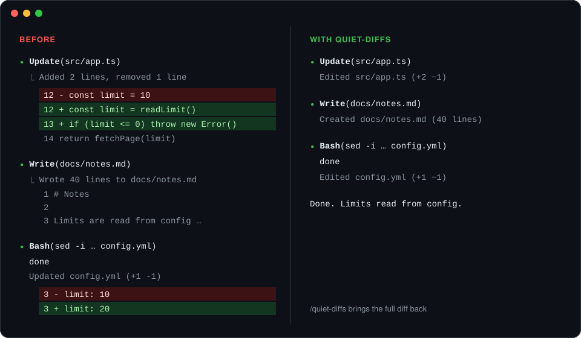

# quiet-diffs

<p align="center">
  <strong>Follow what Claude did, not every line it changed.</strong><br>
  A Claude Code mod that replaces the full diff under each file edit with a one-line summary.
</p>

<p align="center">
  <a href="CHANGELOG.md"></a>
  <a href="LICENSE"></a>
  <a href="https://code.claude.com/docs"></a>
  <a href="hooks/register.tsx"></a>
  <a href="hooks/register.test.tsx"></a>
</p>

<p align="center">
  <a href="#features">Features</a> ·
  <a href="#install">Install</a> ·
  <a href="#usage">Usage</a> ·
  <a href="#development">Development</a> ·
  <a href="CONTRIBUTING.md">Contributing</a> ·
  <a href="CHANGELOG.md">Changelog</a>
</p>



*Illustration of the transcript before and after.*

When Claude Code edits files, each `Edit` or `Write` step, and each shell command that changes files, prints the whole diff into the transcript. Over a long task, those diffs push the steps and Claude's explanations off the screen. quiet-diffs keeps every step visible and turns each diff into a single line with the file path and its added and removed line counts. The change only affects what the transcript draws: the stored tool result, and what Claude reads, stay the same.

> [!NOTE]
> quiet-diffs is built on Claude Code's function-hooks mod API, which is in early access and may change between releases. It was built and tested against Claude Code **2.1.292** and **2.1.296**.

## Features

- **One line per edit:** `Edit`, `Write` and `NotebookEdit` results show the path and `+added −removed` instead of the diff.
- **Shell edits too:** When a Bash command changes files, its output stays and each changed file gets one line instead of a diff.
- **Steps stay visible:** Works with the default transcript view, so tool calls and replies are not hidden as they are in focus view.
- **Toggle on demand:** `/quiet-diffs` brings the full diff back for the session; run it again to return to summaries.
- **Safe fallbacks:** Failed edits, edits held for review and every other tool keep Claude Code's own rendering.
- **Display only:** Nothing is written to your files or settings, and the model's context is unchanged.

| Tool | Shown instead of the diff |
| --- | --- |
| `Edit` | `Edited src/app.ts (+2 −1)` |
| `Write`, new file | `Created docs/notes.md (40 lines)` |
| `Write`, overwrite | `Overwrote config.json (+5 −2)` |
| `NotebookEdit` | `Edited analysis.ipynb (cell abc123, replace)` |
| `Bash` that changes files | Command output, then `Edited notes.txt (+2 −1)`, `Created new.txt (+1 −0)` or `Deleted old.txt (+0 −2)` per file |

## Install

In a Claude Code **terminal** session, run:

```
/plugin install quiet-diffs --marketplace AnnihilationWizard/quiet-diffs
```

1. Answer `y` to add the `github:AnnihilationWizard/quiet-diffs` marketplace.
2. Choose a scope. The **user** scope loads the mod in every session.
3. Claude Code confirms `Installed quiet-diffs. Plugin is now active.` The mod works in the current session without a restart.

To update later, run `claude plugin update`, then `/reload-plugins`.

<details>
<summary>Run from a local clone instead</summary>

```bash
git clone https://github.com/AnnihilationWizard/quiet-diffs.git
claude --plugin-dir ./quiet-diffs
```

To load a clone in every session, add it to the `env` block of `~/.claude/settings.json`:

```json
{
  "env": { "CLAUDE_CODE_PLUGIN_DIRS": "/path/to/quiet-diffs" }
}
```

</details>

## Usage

Once installed, there is nothing to configure. Ask Claude to change a file and the transcript shows the summary line.

| Command | Effect |
| --- | --- |
| `/quiet-diffs` | Show full diffs for this session |
| `/quiet-diffs` again | Return to one-line summaries |
| `Ctrl+O` | Open the detailed transcript (also summarized while the mod is on) |

Two Claude Code settings complete the quiet view. Add them to `~/.claude/settings.json`:

```json
{
  "viewMode": "default",
  "bashEditDiffEnabled": true
}
```

| Setting | Why |
| --- | --- |
| `viewMode: "default"` | Shows each step. Focus view hides steps and only shows the final reply. |
| `bashEditDiffEnabled: true` | Records which files a shell command changed in every permission mode, so quiet-diffs can list them. Without it, Claude Code records them only in auto and `bypassPermissions` modes. Set it to `false` to hide shell edits entirely. |

### Limitations

- A mod cannot tell whether a result is drawn in the `Ctrl+O` transcript, so summaries apply there too. Use `/quiet-diffs` when you need the full diff.
- Claude Code folds some edits into a single group line, such as edits in its scratchpad. Those lines are Claude Code's own and are left as they are.
- Shell edit summaries read a Bash result field that Claude Code marks as internal. If a later release changes it, quiet-diffs falls back to Claude Code's full diff.
- The `/plugin install` command is available in terminal sessions only. A user-scope install also loads in the desktop app's Code tab.

## Development

```bash
claude plugin validate .   # manifest, marketplace file and hooks module
claude plugin test .       # hooks/*.test.tsx against the engine
```

After Claude Code first loads the mod, it writes the API types to `.claude-plugin/types/` (git-ignored). Type-check against them with TypeScript 5.4 or newer:

```bash
npx -p typescript@5 tsc -p .
```

Run `claude --plugin-dir .` to try changes. In an interactive session the folder is watched, and saving a file reloads the mod.

## Project Structure

```text
.claude-plugin/   plugin.json manifest and marketplace.json
hooks/            hooks.json, the hooks module and its tests
types/            state contract for the /quiet-diffs toggle
docs/images/      README illustration
```

## Contributing

Bug reports and ideas are welcome. Read [CONTRIBUTING.md](CONTRIBUTING.md) before opening an [issue](https://github.com/AnnihilationWizard/quiet-diffs/issues) or pull request, and follow [SECURITY.md](SECURITY.md) for security reports.

## License

[MIT License](LICENSE). Copyright © 2026 [AnnihilationWizard](https://github.com/AnnihilationWizard).
